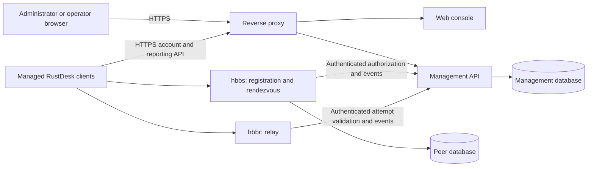

# Architecture: extend the current fork

Status: approved by the owner on 2026-11-10. V1 implementation uses managed
relay-only connections with one-use tickets and a validated HTTPS/WSS origin.
Receiving devices keep the existing UDP registration path; unrestricted direct
connections are rejected while managed mode is enabled.

## Docker architecture addendum (2026-11-11)

Use one process per container and a shared network namespace owned by the Caddy
edge container (`network_mode: service:edge` for the three application services).
This preserves literal-loopback authorization and relay checks without exposing
them on a Docker bridge or using host networking. Caddy publishes the required
ports and proxies HTTPS/WSS to the loopback services. Management, peer data and
TLS state use distinct named volumes; only hbbs/hbbr share the peer-data volume.
The single-VPS stack is not a high-availability deployment. Recreate the whole
stack during upgrades so network-namespace dependencies cannot become stale.

## Components

- A web console for the six selected capabilities, with a React/TypeScript UI.
- A separate Rust HTTP management service, keeping backend maintenance aligned
  with the existing Rust code. Select supported dependency versions during
  implementation and lock them; do not assume the old server dependencies are
  suitable for a newly exposed administration API.
- A service-owned SQLite database for the initial single-VPS installation.
  Concurrent writes, WAL, backup, and expected fleet size require validation;
  horizontal scaling and a shared network filesystem are outside this design.
- Focused authorization integration in the existing hbbs/hbbr services.
- The existing native client, with targeted changes if the compatibility and
  enrolled-device authentication tests require them.

The diagram shows planned responsibilities, not deployed services.

## Deployment shape

Expose HTTPS for the console and native HTTP APIs. Bind backend HTTP listeners
privately behind the proxy. Keep internal authorization routes private even if
they share a process with public API routes. Retain the required RustDesk TCP/UDP
listeners; a normal HTTP reverse proxy does not replace those listeners.

The existing native-only server port plan remains the starting point. Do not
open browser relay/WebSocket ports merely to provide an administration page.
Final addresses, TLS configuration, resource limits, and firewall rules depend
on the actual VPS environment.

## Why this option

It retains the client's and server's current source ownership and makes the new
management state independent of the peer schema. The cost is real engineering
work: authentication, authorization, compatibility, persistence, and maintenance.
This is more work than reusing a complete alternative stack.

BetterDesk is a viable candidate for a separate evaluation if the owner prefers
reuse over retaining the existing server implementation. It is not treated as a
drop-in UI: its Go backend and Node console change this architecture. Approving
that option would require revising these specifications before integration.

## Implementation order after the architecture decision

1. Establish a reproducible local toolchain and client/server compatibility
   fixtures. Trace one complete permitted and denied session handshake.
2. Implement persistent accounts, authentication, groups, grants, and audit,
   with server-side authorization tests.
3. Implement verified device enrollment, inventory, and native API compatibility.
4. Add and test rendezvous/relay authorization, including bypass and replay cases.
5. Connect the console to the real API; verify administrator/operator/viewer flows.
6. Validate with two controlled endpoints and prepare an owner-run VPS deployment
   and rollback procedure. Do not declare production readiness from UI tests.

## Display identity architecture (2026-11-11)

Separate native display names from the existing application identifier used for configuration, service and URI routing. Keep Windows window lookup aligned with the new displayed title. Update the React presentation and Docker image names without changing backend APIs. Preserve the historical release and prepare a newly tested Relivo release. See ../branding.md for the exact regression surface.

## Host Nginx integration (2026-11-11)

Browser/agent -> HTTPS host Nginx -> HTTP 127.0.0.1:18083 -> container Caddy:8088
-> existing loopback API or WebSocket service. Caddy remains the network namespace
owner, preserving server loopback checks. A read-only Caddy configuration mount
selects HTTP ingress; no application image or database schema changes are needed.
Nginx and Certbot run on the host as already installed. Their certificate and
renewal configuration must be backed up separately from Docker volumes.
